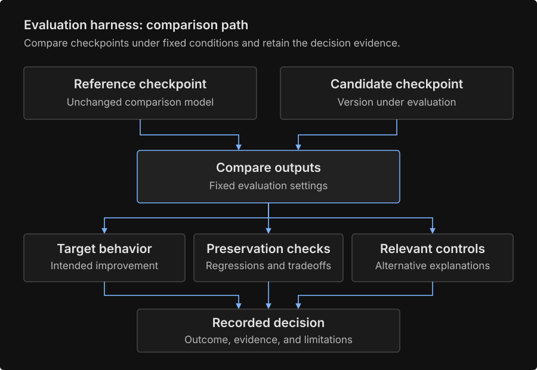

# AI Model Diagnostics and Repair Research

I’m testing whether AI agents can diagnose a failure in a trained model and propose a weight edit that fixes it while preserving other behavior. I build study-specific Python/PyTorch evaluation harnesses to compare the original and edited models and check what else changes. This repository documents the experiments. The implementations and candidate-generation methods remain private.

In one [controlled repair study](#controlled-repair-study), an agent’s edit reduced errors on held-out examples and met the study’s criteria. A follow-up on fresh, more natural data did not establish a useful improvement from the frozen edit.

## Evaluation harnesses

A changed preprocessing step can invalidate a comparison. A crashed process must not reset an agent’s evaluation budget. The harnesses enforce those rules in software.

Each study follows its own experimental protocol. The table describes controls implemented across the study-specific tooling.

| Component | What it does |
| --- | --- |
| Controlled model evaluation | Runs reference and candidate checkpoints with fixed preprocessing, runtime settings, and scoring. It checks repeatability and rejects unexpected changes to model state. |
| Checkpoint validation | Compares an edit with the starting checkpoint, limits which parameters can change, and links the edit to its recorded hypothesis. |
| Persistent evaluation accounting | Tracks the budget across failures and restarts. If the runner cannot determine whether an evaluation was consumed, it stops. |
| Restricted evaluation workers | On supported platforms, workers read evaluation inputs without modifying them, restrict data and network access, and write outputs only to the run directory. |
| Baseline and control comparisons | Compares edits with the unchanged model, random controls, and other baselines. Separate checks measure regressions in behavior the edit should preserve. |
| Experiment records | Records checkpoint identities, settings, outputs, and the decision for each run. |

For future studies, a separate workflow runner ties each reviewed launch configuration to its declared inputs, checks for changed dependencies, and records which stages finished.

## Results and limitations

The studies cover retrieval, object detection, and image–text classification. Each uses its own metrics and preservation checks. The [evaluation record guide](docs/evaluation-records.md) explains what gets recorded for each comparison.

| Study | Result | Limits |
| --- | --- | --- |
| Controlled repair | An agent-proposed edit reduced errors on held-out controlled examples and met the predefined criteria. | Some preservation measurements worsened within the allowed thresholds. The follow-up did not establish a useful improvement on fresh, more natural data. |
| Frozen-edit follow-up | In a separate study, a previously fixed edit improved target-task accuracy on new controlled examples and passed its predefined screen. Measured control decisions stayed unchanged. | Control score margins narrowed, and another prespecified comparator performed better. |
| Planted-damage recovery | Repeated agent sessions recovered most of the performance lost to deliberately introduced damage. | The sessions reused one easy damaged condition with a detectable clue. Some required documented accounting exceptions. Recovery from other faults remains untested in this study. |

In a separate reproduction effort, hashes for the published model artifacts matched the upstream records. Behavioral replay is still pending.

The controlled improvements have yet to establish a generally useful repair method or a consistent advantage over simpler alternatives.

## Inspiration

[Sparks of Weight-Space Programming](https://rikiyat.github.io/blog/weight-space-programming/) inspired this work. Rikiya Takehi, Jayden Teoh, Alex Zhang, and Omar Khattab at MIT CSAIL investigated whether LLMs can inspect and directly edit neural network weights.
